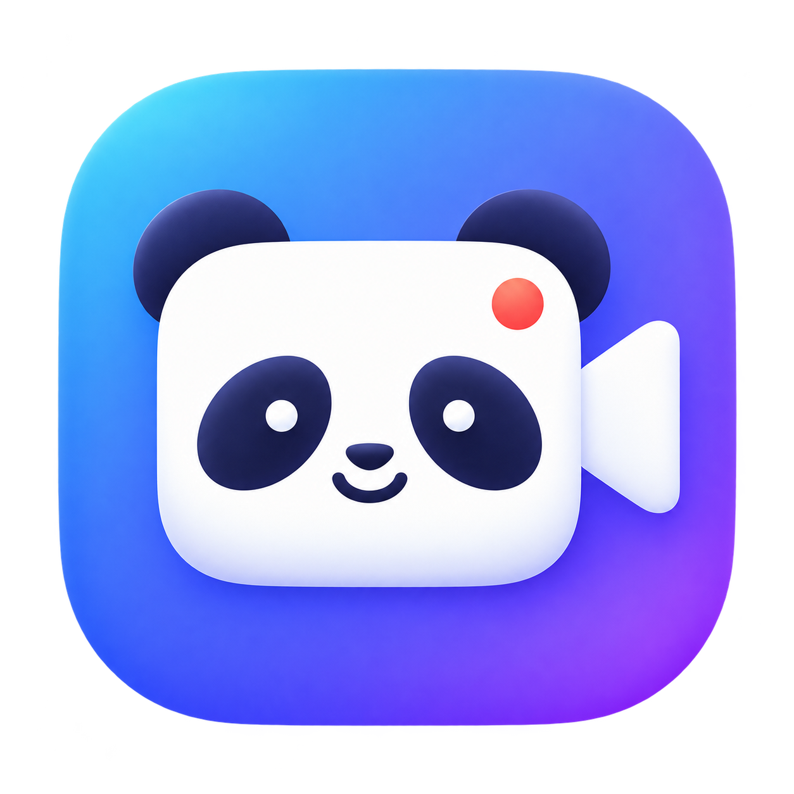

<p align="center"></p>
<h1 align="center">熊猫录屏 · Panda Recorder</h1>
<p align="center">一个简洁的 macOS 录屏工具，录下操作，自动聚焦重点。</p>
<p align="center">
<a href="LICENSE"></a>

<a href="https://github.com/jaylpp"></a>
</p>

## 为什么做这个工具

平时写技术文章、演示软件功能时，我经常需要录屏。录下画面很容易，但想让观看的人看清点了哪里、哪一步是重点，往往还要手动放大和剪辑。

看到 Screen Studio 的自动运镜后，我想试试：借助 Codex 和 REA 研究客户端功能，能不能做一个自己用得上的小工具？熊猫录屏就是这次实践的结果。从录屏和自动聚焦开始，逐步补上了区域选择、声音、计时和多屏支持。

我希望它保持简单：**选好范围，开始录制，停止后就能拿到视频。** 目前仍是早期版本，欢迎一起打磨。

## 有哪些功能

| 功能 | 说明 |
| --- | --- |
| 三种录制模式 | 全屏、单个窗口、自选矩形区域 |
| 多屏选择 | 全屏在目标屏幕点击确认；区域可在任意已连接屏幕拖选 |
| 自动运镜 | 根据录制范围内的鼠标点击平滑聚焦，支持 1.5×、1.75×、2×，也可关闭 |
| 声音录制 | 系统声音和麦克风分别开关；同时开启时合并音轨 |
| 悬浮控制条 | 显示计时，支持停止、重录、取消；菜单栏也可停止 |
| 视频预览 | 录制结束自动显示主窗口；开启运镜时可切换原片和成片 |
| 本地保存 | 导出 MP4，录制和处理在本机完成，无需账号或 API Key |

## 安装与使用

可在 [Releases](https://github.com/jaylpp/panda-recorder/releases) 下载 Apple Silicon 预览版 ZIP，解压后将「熊猫录屏.app」拖到「应用程序」。预览版使用临时签名，未经 Apple 公证，首次打开可能受到 macOS 安全检查限制。请确认来源；若系统提供「仍要打开」，可在「系统设置 → 隐私与安全性」中按提示操作，不建议关闭系统安全保护。

安装包要求 Apple Silicon（M 系列）和 macOS 15 或更新版本；当前仅在开发者的 macOS 26.5.2 上实测，macOS 15 仍待验证。Intel Mac 暂无安装包。也可按下面步骤自行构建。

### 1. 构建应用

需要 macOS、Xcode Command Line Tools，以及包含 macOS 15 API 的 SDK（Xcode 16 或更新版本）。构建脚本面向 Apple Silicon，最低 macOS 15；**麦克风功能需要 macOS 15 或更新版本**。旧版系统和 Intel Mac 尚未完成专项验证。

```bash
# 如果尚未安装命令行开发工具
xcode-select --install

# 获取源码并构建
git clone https://github.com/jaylpp/panda-recorder.git
cd panda-recorder
bash build.sh
open "build/熊猫录屏.app"
```

使用 Swift 和系统原生框架，无需安装 npm 或 Python 依赖。构建产物位于 `build/熊猫录屏.app`，可在 Finder 中双击打开。

### 2. 允许录屏权限

首次使用时，在「系统设置 → 隐私与安全性 → 录屏与系统录音」（部分版本称“屏幕录制”）允许 **熊猫录屏**，然后退出并重新打开应用。开启麦克风时，还需要允许麦克风权限。

本地构建使用临时签名，重新编译后，macOS 可能要求重新授权。如果遇到权限错误，先退出应用，在上述设置中移除旧条目，再添加刚构建的应用并开启权限，然后重新打开。

### 3. 选择范围并录制

- **全屏**：点击「选择屏幕」，在想录制的显示器上点击，再点悬浮条的「开始录制」。
- **窗口**：从列表中选择目标窗口，点击「开始录制」。列表变化时可点击刷新。
- **区域**：点击「拖动选择区域」，在目标显示器拖出矩形，松开后点击「开始录制」。开始前可以重选或取消，框选时按 `Esc` 取消。

录制前按需开启系统声音、麦克风和自动运镜。录制中通过悬浮条或菜单栏停止；重录会沿用当前来源，将本轮素材移到废纸篓；取消会丢弃本轮录制，不生成成片。

停止后自动回到主窗口。开启运镜时等待处理完成，可切换「原片 / 运镜」预览；关闭运镜时只保存原片。

### 4. 获取视频

点击「打开文件夹」。默认保存位置：

```text
~/Movies/REA-MotionRecorder/<session-id>/
```

`original.mp4` 是原片，`motion.mp4` 是开启运镜后的成片。目录中还可能包含点击、鼠标轨迹和录制参数等 JSON 文件，方便排查问题。保存目录沿用项目早期名称。

## 使用边界

- 区域限于单块屏幕，固定在选定位置，不随窗口移动；窗口录制时请保持目标窗口的位置和大小不变。
- 自动运镜依据鼠标点击，不进行 AI 内容识别；无有效点击时不会自动放大，接近录制结尾的点击可能不触发运镜。
- 麦克风使用系统默认输入设备；双声源各以 50% 音量混合。建议使用耳机，减少扬声器声音被麦克风重复收录。
- 已在开发者的 Mac 上验证三种模式、外接屏选择和导出；长时间音画同步、录制中拔屏等场景仍需更多测试。
- 暂无时间轴剪辑、摄像头画中画和字幕功能。视频、音频和鼠标事件数据都保存在本机，分享录制目录前请检查其中内容。

## 开发与贡献

欢迎提交 [Issue](https://github.com/jaylpp/panda-recorder/issues) 和 Pull Request。反馈问题时，请说明 macOS 版本、录制模式、显示器配置、声音与运镜开关，以及复现步骤。截图和样片请先去除隐私内容。

开发入口：

```text
Sources/main.swift       界面、捕获、音频混合、运镜与预览
Assets/                  应用图标及生成说明
build.sh                 本地构建和临时签名
```

建议每个 PR 聚焦一个问题，说明改动原因和实际验证结果。提交前运行 `bash build.sh` 和 `git diff --check`，并按 [贡献指南](CONTRIBUTING.md) 检查相关录制流程。不要提交录制素材、个人路径、凭据或构建产物。

## 实践来源

本项目由 **🐼 熊猫 Jay** 借助 Codex 开发，起于对 Screen Studio 自动运镜体验的研究，研究过程中使用了 REA 和静态分析辅助脚本。录制、编码、界面和预览使用 macOS 原生框架实现，运行和构建不依赖 Screen Studio 或 REA。

项目与 Screen Studio 没有隶属或合作关系，不宣称复现了它的完整实现。关于参考范围、当前运镜实现和图标来源，见 [来源说明](docs/PROVENANCE.md)。

## 许可证

本项目采用 [MIT License](LICENSE)。你可以使用、修改和分发本项目，包括商业用途；分发时请保留许可证及版权声明。项目按原样提供，不作担保。

## 链接作者

Made by **[🐼 熊猫 Jay](https://github.com/jaylpp)**。

我会在公众号 **「熊猫 Jay 字节之旅」** 分享 AI 工具、开发实践和自己的探索，欢迎关注和交流。

<p></p>

其他项目：[Pandajay Skills](https://github.com/jaylpp/pandajay-skills) · [汉语新解 Chinese Insight](https://github.com/jaylpp/chinese-insight)
